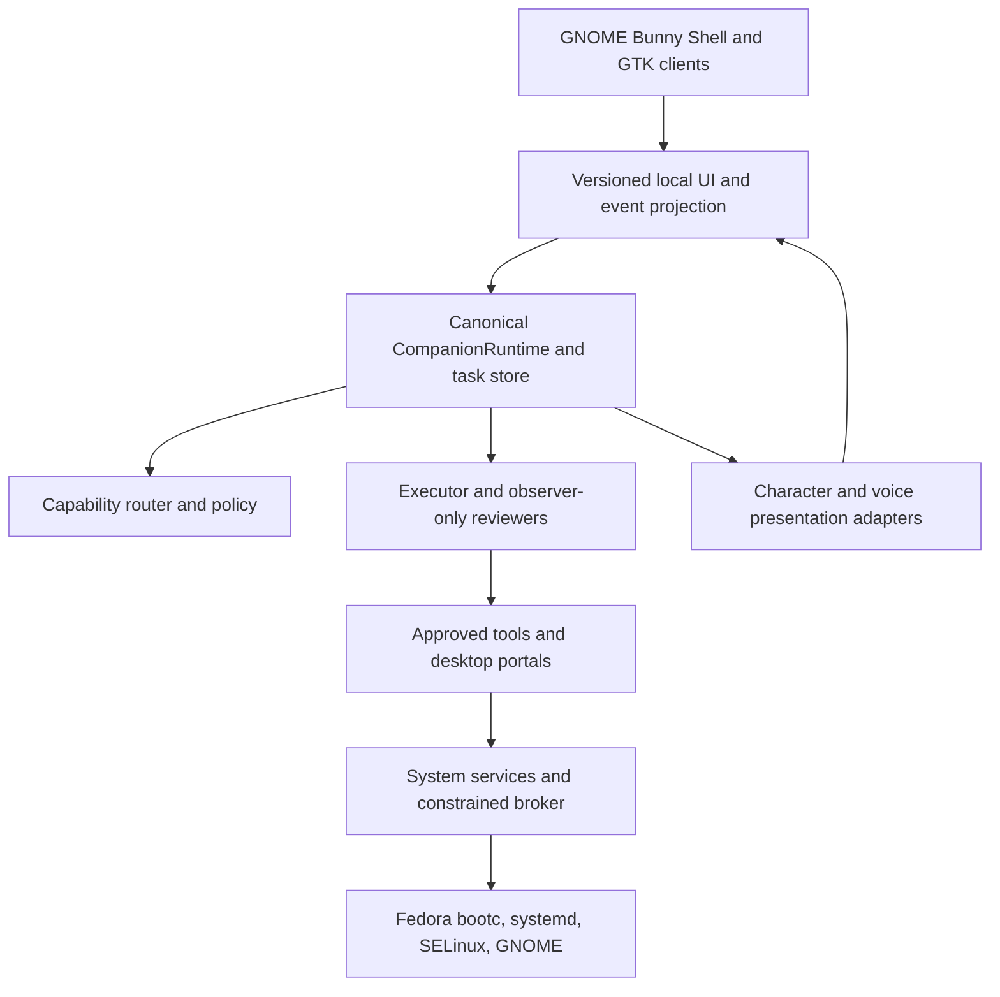

# Bunny OS 2 Adaptive Hybrid Desktop Architecture and Experience Specification

**Status:** Proposed design specification, not an implementation or release qualification  
**Prepared for:** Ravi Teja Allamsetti and the Bunny OS engineering workflow  
**Date:** 7 November 2026  
**Repository:** [COMRADEART/bunny-os](https://github.com/COMRADEART/bunny-os)  
**Read-only design baseline:** `main` at `22e970d096d4867f986933fc86fb6768631fc30d` (11 September 2026)

> **Primary-session update (2026-11-07):** ADR-031 and project preference select **Hyprland** as the primary Bunny customization compositor. Safe Shell and transitional `bunny-gnome` remain GNOME. Layout, rail, a11y, and security invariants in this Spec still apply. See `docs/ADAPTIVE_HYBRID_HYPRLAND_RECONCILIATION.md`.

## 1. Decision and intended outcome

Bunny OS will use an **adaptive hybrid desktop**: a conventional, fully usable Linux desktop with a task-centered AI workspace and a responsive humanoid companion. The user can move between ordinary applications, an expanded agent workspace, and a focused creation canvas without changing the operating system or task authority. A task continues across layout transitions, companion renderer degradation, UI restarts, model unavailability, and supported service recovery.

This proposal develops the existing product architecture. It does not authorize a new kernel, a replacement compositor, a second task event store, a second permission authority, or a full rewrite in another programming language. Release evidence and existing security constraints remain controlling. No new image, VM, microphone, physical device, or accessibility test was run to create this design.

The design must answer three questions on every task-bearing surface: **What am I doing? What is Bunny doing? What can I do next?** These are already present in `docs/DESIGN_SYSTEM.md` and remain the central acceptance criterion.

## 2. Existing assets and preservation contract

### 2.1 Evidence-based inventory

The current repository has Fedora 44 bootc image definitions, GNOME 50/Mutter Wayland session integration, GNOME Shell extension and GTK4 surfaces, systemd user services, a constrained root broker, a capability runtime, a Companion runtime, task/event schemas, a generated design-token system, character packages, an OpenGL 3.3 humanoid renderer, local model and voice integration seams, and extensive source/host qualification tools.

The critical components to reuse are:

| Existing authority or asset | Current source | Design treatment |
|---|---|---|
| OS base and recovery | `ARCHITECTURE.md`, `build/`, `systemd/`, `services/`, `docs/RECOVERY.md` | Preserve bootc deployments, GNOME/Mutter, systemd, SELinux, Polkit, recovery and conventional CLI access |
| Capability and resource decisions | `capability/`, `docs/CAPABILITY_RUNTIME.md` | Reuse deterministic hardware discovery, budgets and explanations; do not introduce product-tier modes |
| Task lifecycle and durable truth | `companion/states.py`, `companion/events.py`, `companion/store.py` | Extend the existing typed event contracts only through compatible versioning; no parallel task database |
| Presentation and approvals | `companion/presentation.py`, `companion/approvals.py`, `docs/APPROVAL_CENTRE.md` | Render authoritative projections; retain scoped, expiring, fail-closed Trust decisions |
| Character system | `companion/character/`, `docs/COMPANION_3D_RENDERER.md` | Improve the existing validated GLB, animation mixer and adaptive renderer; retain 2D/static/text fallbacks |
| OS shell and design | `shell/components/gnome-shell-extension/`, `docs/DESIGN_SYSTEM.md` | Evolve the GNOME extension, GTK clients, generated tokens, accessibility and safe shell |
| Product vision and evidence | `demos/10-product-vision/`, `docs/UI_UX_POLISH_REPORT.md` | Treat host HTML previews as visual evidence only; require guest/hardware evidence for release claims |

The `README.md` and `NEXT_PHASE.md` distinguish source features from runtime qualification. Their recorded stable release verdict is **NO-GO**, and pilot gates are blocked. The new design must not claim otherwise. The `README.md` contains historical dated status tables, so the implementation agent must recheck the current authoritative release reports and gates before reporting status.

### 2.2 Non-negotiable invariants

1. The Linux kernel, systemd, GNOME/Mutter and bootc retain their present authorities. GDM must still offer base GNOME and Bunny Safe Shell.
2. The privileged `bunny-system-broker` keeps its allowlisted contract, authenticated peer checks, local session and operation-specific Polkit gate. No generic root command, shell proxy or arbitrary file mutation is added.
3. `CompanionRuntime`, the canonical `TaskEvent` sequence and `PresentationProjector` remain the only sources of task lifecycle and display truth. The UI never decides a task succeeded.
4. Capability profiles derive from measured resources, not product tiers or marketing labels. Only fidelity and concurrency can adapt beneath established limits.
5. Existing memory and network consent defaults remain restrictive. No silent microphone, screen capture, file upload or remote model escalation.
6. Unknown operation outcomes are not silently replayed after a crash. Recovery returns through the defined state machine and re-evaluates operation keys.
7. The character can be disabled. Keyboard, files, terminal, settings, notifications, recovery and Trust prompts remain fully usable.
8. Generated theme artifacts are rebuilt from the authoritative `tokens.js`; never edit generated CSS/JSON as the primary source.
9. A design prototype, host render or passing source test is never evidence of a booted session or hardware qualification.
10. Preserve license attribution, test fixtures, historical evidence and unrelated branches. Work on a new feature branch with no destructive cleanup.

## 3. Product architecture

### 3.1 Layered system

This diagram is conceptual. It does not replace existing control-flow contracts. In particular, approvals and OS permissions are verified at the runtime and the respective tool/broker boundary, not granted by the shell.

### 3.2 Component ownership

| Component | Owns | Must never own |
|---|---|---|
| Bunny Shell GNOME extension | Top bar entry points, launcher projection, dock, focus workspace transitions, spatial layout, task status surfaces | Task truth, approvals, arbitrary input injection, kernel or compositor control |
| GTK4 Companion client | Character display, captions, user commands, accessible Trust handoff, diagnostics | Executor routing, credentials, raw task/event parsing into independent state |
| CompanionRuntime | Session/task identity, event sequence, leases, recovery, privacy classification, user-facing state projection | Compositor control, root privilege, character animation policy |
| Capability runtime | Hardware observation, policy evaluation, budgets, service capability explanations | Executing its own proposed plan or inventing measurements |
| Executor/ToolBroker | Bounded task operations after authorization, idempotency keys, cancellation | Unrestricted shell/root access or final task success without observations |
| Reviewer adapters | Read-only redacted evidence and bounded quality observations | Tools, approvals, provider selection or file writes |
| Character presenter | Projection-to-pose mapping, validated packages, LOD, animation and lip sync | Reading task store, microphone capture, network calls, tool execution |
| System broker | Fixed OS methods with session and Polkit checks | Generic automation or privileged model runtime |

### 3.3 IPC and event contracts

The existing installed Companion service uses a private Unix socket under `$XDG_RUNTIME_DIR`, with peer identity verification where supported. Retain this transport and its versioned request/response contracts. Avoid introducing another message broker until a measured need exists. UI processes subscribe or poll through bounded event replay; they resume from the last acknowledged per-task sequence after reconnecting.

Every event used by the UI must include the existing schema fields: `schemaVersion`, `eventId`, `sessionId`, `taskId`, `sequence`, `eventType`, `occurredAt`, `source`, `recordKind`, `payload`, `description` and `evidenceReferences`. A projection adds its `stateRevision` and display hints. Do not place chain-of-thought, credentials, raw microphone samples or arbitrary tool payloads in the UI projection.

Recommended extension procedure: determine whether the desired field belongs in the canonical event, the derived presentation state, or a purely local visual preference. Add a versioned schema change only for a true new domain fact. Ship a backward-compatible reader, migration test, replay fixture and compatibility check before a writer emits the new version. Unknown event types should degrade to a truthful generic status, not fabricate a task outcome.

### 3.4 Agent and model orchestration

Use the established one-executor lease and observation-only reviewer pattern. Each task has a typed plan, bounded tool authority, cancellation path, recovery rules and explicit outcome evidence. Route locally where capability and policy permit; explain refusal or remote escalation without treating cloud access as automatic. Existing Bunny A routing may be integrated only through an adapter that honors Bunny OS schemas, consent, contracts and version compatibility; sharing product branding is not authorization to share hidden state or credentials.

Do not create a second global planner or arbitrary command bridge inside the UI. The shell may suggest and preview a plan, then submit through the canonical Companion gateway. Execute only after the required confirmations, budget checks and tool-level permissions.

### 3.5 Data and privacy architecture

Retain the existing durable event store, retention rules, per-task sequence, redaction and integrity checks. The workspace index and user preferences remain separate from task truth. Memory should be optional, scoped by session/durable/cloud consent, and revocable with a visible deletion path. Sensitive surfaces display a local/remote indicator and which connector or provider will receive data. Logs use identifiers, bounded summaries and redaction, never secrets or raw personal content.

### 3.6 Failure boundaries

| Failure | Required behavior |
|---|---|
| Model unavailable or network offline | Desktop remains usable; typed fallback and an explicit refusal or local route; no surprise cloud switch |
| Companion daemon crashes | GNOME, dock, files, terminal and Safe Shell work; UI says disconnected; service restart replays authoritative events |
| Renderer or GPU context fails | Release graphics resources and degrade through validated 2D/static/text ladder; task continues |
| Approval expires or changes scope | Reject action and return to authoritative Trust flow; never reuse old scope |
| Tool outcome is unknown after interruption | Record unknown and require recovery/reconciliation; do not repeat a potentially destructive operation |
| Extension fails | GNOME base session remains available; Safe Shell bypasses Bunny components |
| Update image fails | Bootc rollback/recovery and evidence remain available independently of the AI |

## 4. Adaptive hybrid interaction model

### 4.1 Three workspace layouts, one task system

These are **visual layouts**, not machine capability modes:

- **Desktop:** Conventional app windows, GNOME overview, launcher, Files and Terminal. Bunny is a compact, non-blocking companion with a single status indicator.
- **Focus:** One primary work surface fills most of the display. A collapsible task rail holds plan, tool calls, approvals and checks. Bunny retreats to a smaller corner footprint.
- **Studio:** A user-invoked expanded workspace for multi-file creation, coding, planning and visual review. The center becomes a canvas with task cards, artifact previews and controlled agent activity. The companion may be prominent only in free space.

Layout changes preserve the same task ID, event cursor, approval state and artifacts. They do not restart an agent. User choice takes precedence over automatic suggestions; fullscreen apps and screen sharing may suppress decorative overlays automatically without changing task execution.

### 4.2 Navigation and window rules

- **Top bar:** Retain GNOME system controls. Add a compact Bunny launcher/status entry, with no redundant always-visible telemetry wall.
- **Dock:** Responsive app/workspace navigation. A task badge represents actual active or pending work; clicking opens the canonical task timeline.
- **Command surface:** Super+Space where the existing binding is verified, with a visible accessible alternative. Parse local application/search intent separately from agent requests. Preview potentially risky operations.
- **Task rail:** Shows stage, specific executor, tool, observed progress, reviewer warnings, files, estimated costs if grounded, Pause, Cancel and open Trust requests. No arbitrary percentage without measured numerator and denominator.
- **Notifications:** Summarize routine events; approval, failure and privacy transmission remain visible and keyboard accessible. Suppress sensitive content on lock screen.
- **Desktop windows:** Preserve Mutter placement, GNOME overview, snap and multi-monitor behavior. The companion cannot claim unrestricted absolute Wayland placement or steal focus during refresh.
- **Safe Shell:** One visible recovery route from login and settings that avoids Bunny extension/runtime dependencies.

### 4.3 Key journeys

**Build software.** User enters a request; Bunny shows a brief plan and required permissions; user approves exact affected paths and tools; the task timeline shows observed execution and tests; deliverables appear with provenance; completion is announced only after the relevant checks. The user can open the generated files through normal applications.

**Ordinary desktop use.** User opens Files, changes Wi-Fi, snaps two windows and launches a terminal without needing Bunny Core. The companion may remain ambient or hidden. Normal system shortcuts and assistive technology work.

**Interrupted work.** A task is paused or loses its executor. UI shows paused/disconnected/recovering truthfully. On reconnect, event replay restores the stage, unknown operations are reconciled, and user consent is re-requested when invalid.

**Offline voice.** Push-to-talk displays a microphone indicator before capture, shows transcription, requests confirmation when needed, then routes through the same task gateway as typing. If Vosk/model/physical mic is absent, text remains available and the voice stage is `NOT_RUN` or unavailable, not passed.

**Permission-sensitive action.** Trust states Who, What, Why, How long, exact files/application/provider destination, risk, reversibility and cost where known. Deny remains default focus and Escape denies. An expired or altered request performs no action.

### 4.4 Responsive geometry

At 1280x800 and 1366x768, the task rail becomes a drawer and companion bounds shrink without covering file actions. At 1920x1080 and higher, Focus and Studio may use a side task rail. At 150% and 200% text scale, all controls reflow and the permission prompt keeps its actions in view or scrolls deliberately. Multi-monitor selection remains user controlled. Fullscreen and lock screen must not be obstructed. On Wayland, only use window positioning and focus behavior that GNOME/Mutter or supported APIs actually guarantee.

## 5. Visual and motion specification

### 5.1 Brand and themes

Retain Bunny's original rounded-arc identity, violet interactive accent and Bunny Blue presence indicator. Default appearances are **Graphite Glass** and **Silver Liquid Glass**, implemented as tuned dark/light variants of the existing four accessible token families (`light`, `dark`, `highContrastLight`, `highContrastDark`). Avoid a separate hard-coded palette.

| Token group | Proposed behavior |
|---|---|
| Surfaces | Crisp hierarchy: base, raised, overlay, dialog; glass only where separation helps |
| Glass intensity | User-controlled 0-100 preference, mapped to tokenized opacity, border, highlight and blur ceilings; high contrast overrides to opaque |
| Typography | System UI font and system monospace; no dependence on an unshipped custom font |
| Accent | Violet for actions; Bunny Blue for character presence only; never rely on color alone for status |
| Radius and spacing | Reuse semantic controls and generated token scale; no one-off page CSS values |
| Motion | Preserve UI 150-350 ms and companion 300-700 ms budgets where appropriate; reduced motion sets all decorative durations to zero |
| Contrast | Check composited text and controls in all four accessible themes against project gates and WCAG requirements |

The glass slider changes presentation only. It cannot change security/permission contrast, accessibility preferences, system-level performance policy or the asset trust model. A dark or light visual setting must preserve GNOME high-contrast preference and readable fallback when blur/GL is unavailable.

### 5.2 Humanoid art direction

The companion is a consistent, original human-shaped character with an expressive face, skeletal body rig, restrained clothing/material design and subtle physical presence. The repository currently defines a warm-faced stylized human in black clothing and an existing `bunny-humanoid-1` skeleton. Treat this as the default identity until a reviewed character asset revision is approved. Do not replace it silently with a different photorealistic person, an unlicensed third-party model or a visual generated in a mockup.

Improvement targets are proportion/rig consistency, hand/eye motion, measured lip synchronization, clean materials, camera framing, self-shadow quality where economical, and readable silhouette at small sizes. Avoid continuous idle gestures that waste power or distract from user work. A model package still requires a valid GLB, trusted manifest boundaries, digests, a static fallback, provenance and license.

### 5.3 Companion sizing and placement

- Ambient: small status presence, typically corner-anchored; can hide completely.
- Compact: torso or portrait, captions up to three short sentences; user activates expanded detail.
- Full: optional body pose within Studio's allocated canvas; never overlays an approval action or code text.
- Anchors: preserve active-monitor preference and scale, but use deterministic window directives and GNOME-compatible positioning. Report unsupported arbitrary coordinates honestly.
- Dragging is a user action; screen-reader focus and menu access do not depend on dragging.

## 6. Humanoid state machine and behavior contract

### 6.1 Three distinct vocabularies

Do not merge these distinct source-defined layers:

1. **Task state:** `companion/states.py` defines 16 lifecycle states including `planning`, `executing`, `reviewing`, `waiting_for_approval`, `recovering`, `paused`, `cancelling`, `completed`, `failed`, `cancelled`.
2. **Presentation phase:** `companion/presentation.py` derives what can be shown from ordered, redacted events with priority handling.
3. **Character/Visual Keys:** `companion/character/mapper.py`, `companion/visual_keys.py` and shell `companionVocabulary.js` map authoritative presentation into poses and task-specific activity. The shell's 17 named companion states and the product-vision 15 Visual Keys are *different projections*, not competing lifecycle stores.

### 6.2 State projection table

| Canonical event or phase | User-facing label | Humanoid behavior | Priority / accessibility |
|---|---|---|---|
| Idle / task absent | Ready | Neutral breathing or still frame | Ambient; no implied active work |
| Listening | Listening | Head/eye orientation, mic badge, minimal ear/face response | Capture indicator before microphone starts |
| Understanding / classifying | Understanding | Brief attentive gaze | Caption names what was understood, not reasoning trace |
| Planning | Planning | Examines a small task model or schematic | Plan stage visible; no invented percentage |
| Executing / operation progress | Working, Coding, Reading, Searching | Subtle pose/activity variation based on validated tool category | Tool status reflects real event |
| Reviewing | Verifying | Inspecting or considered posture | Reviewer is observer-only; warnings visible |
| Waiting for approval | Permission needed | Stops work motion and points toward Trust surface | Persistent prompt; outranks decorative work |
| Paused / cancelling | Paused / Stopping | Motion settles to neutral | Cancellation cannot be misreported as stopped |
| Recovering / connection lost | Reconnecting | Low-energy neutral pose | No false continuation or success |
| Completed / presenting result | Completed | Short acknowledgment, then idle | Only after `task_completed` evidence |
| Blocked / capability unavailable | Needs attention | Concerned but non-alarming pose | Explain limitation and next action |
| Failed | Could not complete | Immediate alert posture, then still | Persistent failure copy; whether anything changed |
| Offline / disconnected | Offline / Disconnected | Static lower-fidelity presence | Distinguish intentional offline from fault |

### 6.3 Priority and transition rules

Priority is taken from the existing `PHASE_PRIORITY` and `priority_rank`, not a new animation table. Approval, error, blocked, warning, cancellation and loss of connection preempt ordinary motion. A purely visual activity can refine `working` into `typing`, `researching` or `reading`, but cannot hide an authoritative error or consent request.

Frame updates are monotonic by projection revision. Ignore stale visual updates. After reconnection, replay canonical events and rebuild the pose from the latest valid projection. Never regenerate task truth from an animation. Use the existing bounded mixer and limit crossfades. Reduced-motion immediately switches frame/pose without interpolated motion. No decorative animation may acquire microphone, camera, desktop or network privileges.

### 6.4 Rendering fallback and resource policy

Reuse the existing ladder `full-3d -> lightweight-3d -> animated-2d -> static-image -> audio-only -> text-only`, subject to the build's available implementations and user/accessibility preference. The capability plan is an upper bound. The renderer may degrade quickly under GPU, memory, battery, thermal or display pressure; recovery needs hysteresis and healthy samples. The task always continues independently.

Existing OpenGL 3.3 rendering, package validation, resource ledger, static fallback, speech viseme stream and deterministic scene setup are the first optimization targets. Measure before replacing them. Do not add a second engine, game loop or uncontrolled shader loading. The renderer must stay prohibited from importing runtime, store, tool or network modules.

### 6.5 Minimum animation acceptance suite

- Enumerate every task lifecycle state and prove a safe, accessible visual projection and text fallback.
- Test approval/error priority against an in-flight work animation.
- Test stale revision, replay, out-of-order visemes, cancellation and speech end.
- Test GPU context loss, bad GLB, renderer restart limit and zero resource ledger after release.
- Test 100%, 150%, 200% text scale, reduced motion, high contrast and keyboard-only operation.
- Test avatar hidden with task actions still available and no unexpected focus capture.

## 7. System optimization strategy

### 7.1 Establish baselines first

Track a fixed tuple for every result: commit SHA, OS image digest, kernel, graphics stack, CPU/GPU/driver, display layout and scale, power state, test environment, sample count, warm/cold condition and measurement tool. The repository's `docs/PERFORMANCE.md` already proposes desktop warm-launch and idle targets; reuse them as starting thresholds and rebaseline with actual GNOME guest/hardware measurements.

| Metric | Existing or proposed acceptance target | Evidence source |
|---|---|---|
| Post-authentication interactive desktop | Existing target <=15 s on Fedora/QEMU reference | `systemd-analyze`, guest trace, repeated boots |
| Warm launcher or command field | Existing target <=150 ms | End-to-end input-to-visible-frame timestamps |
| Local 20k-entry metadata search | Existing target <=100 ms | Indexed realistic fixture, p50/p95/p99 |
| Warm settings | Existing target <=500 ms | End-to-end GUI timing |
| Mutter workspace switch | Existing target <=250 ms | Measured GNOME session, no synthetic shortcuts substituted |
| Bunny-owned idle process aggregate | Existing target <=250 MiB RSS and <=1% of one CPU | Cgroup and process accounting, model unload confirmed |
| Sustained idle GPU work | Existing target none attributable to Bunny | GPU trace/counters where available |
| Animation smoothness | Proposed >=95% of frames within 16.7 ms at 60 Hz on supported target | On-device frame-time trace, warm-up excluded |
| OS survival under AI/render crash | Proposed 100% of defined fault-injection scenarios | Fault injection plus session usability check |

Existing performance numbers from Python source-host microbenchmarks cannot be cited as desktop, GPU, voice, actual indexed-search or hardware measurements. Every new result must say `PASS`, `FAIL`, `NOT_RUN` or `BLOCKED` with the evidence artifact and target tuple.

### 7.2 Optimization order

1. **Remove duplication:** one state projector and one task store, deduplicated subscriptions, no second UI polling loop, no redundant live telemetry.
2. **Keep work off GNOME's main thread:** bounded IPC, asynchronous UI updates and request coalescing; no model inference or file indexing inside shell callbacks.
3. **Cap character cost:** draw only on visible state changes or intentional animation, suspend hidden/fullscreen scenes, cache validated resources, enforce resource ledger cleanup.
4. **Resource-aware model lifecycle:** start local workers on demand; enforce capability-derived budgets; avoid background GPU reservation while the user needs the GPU for coding, games or rendering.
5. **Index incrementally:** bounded, private metadata indexing; use app/file portals; avoid periodic full-home scans.
6. **Preserve power:** respond to GNOME power profiles, thermal and memory pressure, but do not rebrand them as Bunny capability editions.
7. **Keep storage bounded:** logs, screenshots, model caches, crash reports, thumbnails, checkpoints and update reserve; give user-visible cleanup previews.

### 7.3 Measurement matrix

Run source tests on the development host, graphical guest tests on a documented Fedora 44 image-built QCOW2, and hardware tests on a supported physical machine. Cover integrated/limited GPU, the Lenovo Yoga Pro 9i class (RTX 4050), single/dual monitor, HiDPI, AC/battery, offline, memory pressure, reduced motion, screen reader, cold/warm start and prolonged idle. Never substitute an HTML demo, generic QEMU screenshot or unit test for these gates.

## 8. Security, accessibility and release qualification

### 8.1 Security

All privileged mutations pass the established broker, Polkit, peer identity and exact method allowlist. User files, screenshots, audio and remote provider calls use user-mediated scope and visible transmission indicators. Third-party models, character packages and plugins remain data-only or sandboxed with validated provenance. Preserve SELinux confinement and the existing negative tests for path/app/provider drift, expiry and replay. Separate user approval from system authorization.

### 8.2 Accessibility

Every meaningful state is announced in text and accessible semantics; the humanoid is supplementary. Preserve AT-SPI names and the existing Trust automation contract, especially `Allow this Bunny action` and `Deny this Bunny action`. Deny must retain default focus/Escape behavior. GNOME/Orca, high contrast, 200% text scale, reduced motion, keyboard-only flows and a hidden character must all work in a booted session. Captions remain available without voice output.

### 8.3 Evidence and release

Do not change an existing stable/pilot gate to pass because a redesigned screenshot looks good. Required proof includes a newly composed, digest-identified shell-test image, booted GNOME session, Trust journey via AT-SPI, observed voice path on microphone/speaker hardware when claimed, 2D/3D rendering on a real GL device, performance traces, update/rollback, recovery, installer, Secure Boot/TPM where required, vulnerability disposition, independent reviews and production signing approvals. `NOT_RUN` stays `NOT_RUN` until the corresponding environment produces evidence.

## 9. Migration sequence and milestones

Each milestone is a small feature branch/PR against a known base, with protected paths and explicit non-goals. Do not merge past an evidence gate by weakening tests.

| Milestone | Work | Exit evidence |
|---|---|---|
| M0 Baseline and contract inventory | Recheck main, branch state, docs, schemas, existing tests, current artifact qualification and design tokens | Read-only architecture delta and baseline measurement plan |
| M1 Adaptive workspace shell | Desktop/Focus/Studio projection in GNOME extension and GTK surfaces, no task-engine changes | Keyboard/a11y/geometry tests, safe-session fallback, host screenshots |
| M2 Visual continuity | Tokenized graphite/silver appearances, glass control, task rail, captions, responsive state | Four-theme contrast, 100/150/200 scale, reduced motion, no generated-token drift |
| M3 Humanoid polish | Existing GLB/rig/renderer improvements and activity mapping | Validated package + GPU draw proof, fallback and priority tests, resource ledger zero |
| M4 Orchestrator integration | Bridge shell plans/results to canonical Companion gateway; optional Bunny A adapter behind explicit contracts | No second authority; permission negatives, replay/cancel/recovery, provider privacy tests |
| M5 Profiling and resource budgets | Real baseline traces; off-main-thread work; caching, LOD, idle resource changes | Before/after measured on same test tuple; no regression to user apps |
| M6 Guest and hardware qualification | Composed image, boot, AT-SPI, GNOME/Mutter, voices, security, rollback | Each gate with exact digest/commit; explicit GO/NO-GO not presumed |

### 9.1 Required per-PR report

Every change report includes base/head SHA, diff scope, preserved contracts, source tests and counts, guest/hardware tests with PASS/FAIL/NOT_RUN, performance evidence and regressions, security and accessibility negative tests, artifacts/digests, remaining blockers and recommended next safe step.

### 9.2 Stop conditions

Stop if a proposed change would broaden root permissions, bypass consent, overwrite a canonical store, break Safe Shell, alter release evidence, introduce unexplained dependency licenses, or assert results from a test environment that did not run. Stop and ask the owner before replacing the default humanoid identity, changing the GNOME foundation or pursuing a new compositor.

## 10. Decisions and open questions

1. **Chosen:** Adaptive hybrid layout; Fedora 44 bootc + GNOME/Mutter foundation; existing Python Companion runtime; one canonical event store; existing verified 2D/3D renderer path; four accessible token families.
2. **Proposed:** Graphite Glass and Silver Liquid Glass as user-facing default theme names; glass intensity control; Desktop/Focus/Studio layout vocabulary; more prominent task rail; more refined humanoid asset within the existing character identity.
3. **Requires audit:** Current branch/PRs beyond `main`, latest image-builder availability, precise GTK/GNOME layering behavior, whether current 3D asset has been exercised in a booted session, release blocker counts, and hardware performance budgets.
4. **Requires explicit owner sign-off:** A new default character design, moving core runtime code to Rust, replacing GNOME/Mutter or changing memory/network defaults.

## 11. Repository references

The principal source authorities inspected at the pinned main revision were `README.md`, `ARCHITECTURE.md`, `NEXT_PHASE.md`, `docs/CAPABILITY_RUNTIME.md`, `docs/DESIGN_SYSTEM.md`, `docs/COMPANION_RUNTIME_CORE.md`, `docs/COMPANION_INTEGRATION.md`, `docs/COMPANION_3D_RENDERER.md`, `docs/COMPANION_CHARACTER_RENDERER.md`, `docs/UI_UX_POLISH_REPORT.md`, `docs/PERFORMANCE.md`, `docs/POWER_AND_PERFORMANCE.md`, `docs/APPROVAL_CENTRE.md`, `docs/AI_VOICE_PIPELINE_PLAN.md`, `companion/states.py`, `companion/presentation.py`, `companion/visual_keys.py`, `companion/character/mapper.py`, `schemas/companion-event.schema.json` and `shell/components/gnome-shell-extension/lib/design/tokens.js`.

Review these files in the live repository before implementing. This specification supplements them; it does not supersede current security, release, data compatibility or licensing authority.
